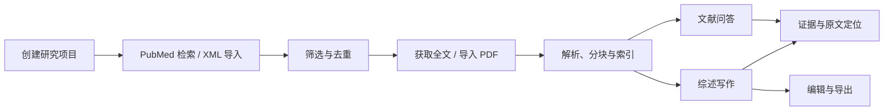

# ScholarNoteLM 项目规划

> 历史设计记录（2026-09-19），下方“待接入”等状态不代表当前版本。现行操作见 [README](README.md) 与 [文档索引](docs/README.md)；已移除的重排、旧清洗策略和 PaddleOCR 不应按此规划恢复。

> 更新日期：2026-09-19  
> 状态：v0.4 已接入真实 PubMed 检索、检索助手、MeSH/JCR 与 PDF 下载；全文解析、RAG、综述生成仍待接入。  
> 当前进度与实际运行方式见 README.md；PDF 下载实现见 docs/PDF_DOWNLOADS.md。下方早期规划保留为设计记录。

## 1. 项目目标

构建一个运行于 macOS 和 Windows 的一站式文献研究桌面应用，名称为 **ScholarNoteLM**。

应用以研究项目为单位，串联 PubMed 检索、文献管理、PDF 全文获取、结构化解析、向量化、基于文献的问答以及综述写作。问答体验参考 NotebookLM，证据检索与回答生成思路参考 PaperQA2。

产品定位：**本地优先、以研究项目为单位、结论可追溯到文献证据的研究工作台。**

核心要求：

- UI 现代、优雅，阅读和写作体验清晰、舒适。
- 长耗时任务在后台执行，保持界面流畅。
- 支持中英文文献研究和综述写作。
- 项目、文献、证据、笔记、问答与草稿形成完整的数据闭环。
- 应用可控制的代码、依赖、运行时、模型、安装包、配置、缓存和数据集中存放于指定根目录。

## 2. 已确定的方向与待验证事项

### 已确定

- 项目名称为 ScholarNoteLM，目标平台为 macOS 和 Windows。
- 使用项目化管理，默认隔离不同项目的检索范围。
- 以 PubMed 为首要检索入口，支持 XML 与 PDF 导入。
- 支持文献问答与综述写作，两者共用证据检索系统。
- 综述基本路线为：摘要生成大纲，末级节点检索证据，分节生成并整合全文。
- 采用本规划的目录结构作为后续实施参考。
- **第一阶段先做 UI，确定视觉风格与交互，不以真实后端闭环为前提。**

### 推荐但尚未锁定

- Tauri 2 + React + TypeScript 桌面界面。
- Python 独立研究引擎。
- SQLite 业务数据存储，LanceDB 作为本地检索索引优先候选。
- 本地解析与向量模型，加可配置云端问答/写作模型，作为初步默认方案。
- 复杂 PDF 解析以现有 Marker 流程为基线，与 Docling 等候选比较。

### 后续需要明确

- 主要设备的芯片、内存与显卡配置。
- 首先个人使用，还是向其他用户发行。
- 是否要求问答和写作模型完全本地运行。
- 首发支持的系统版本、CPU 架构和典型文献规模。
- UI 风格经原型评审后确定，当前建议不视为最终设计。

## 3. 第一阶段：UI 原型与风格确定

### 3.1 阶段目标

先交付一个可以实际浏览和操作的界面原型，验证以下问题：

1. 产品整体是否现代、优雅，适合长时间阅读和写作。
2. 项目、文献、问答和综述之间的导航是否自然。
3. 用户能否清楚理解文献处理状态、答案依据和写作进度。
4. 核心页面在桌面窗口中是否舒适，布局是否适应窗口大小变化。

本阶段使用模拟数据和可替换的数据接口。原型中的下载、解析、问答和生成内容明确标识为演示，不表示真实任务已执行。

### 3.2 推荐视觉方向

以克制的学术研究工具风格为起点：清晰的字体层级、适当留白、细腻边界、少量强调色、稳定的阅读宽度与轻量动效。

- 首先精修浅色主题，建立可扩展到深色主题的颜色变量。
- 尝试温和的中性色背景与单一低饱和强调色，具体配色通过原型确认。
- 图标风格统一，按钮和状态标签层级明确。
- 文献列表重视信息密度，问答与正文重视阅读舒适度。
- 加载状态、空状态、错误与成功状态采用一致的设计语言。
- 尽量使用本地字体资源或系统字体，避免界面依赖远程字体服务。

### 3.3 界面布局

采用可折叠的三栏布局：

- 左侧：项目切换与功能导航。
- 中间：文献列表、阅读内容、问答或综述编辑区。
- 右侧：文献详情、证据卡片或原文预览，按需展开。

右侧面板不强制常驻；较小窗口中可收起为抽屉。研究内容应始终拥有足够宽度。

### 3.4 首轮页面范围

| 页面 | 主要内容 | 原型需要体现的交互 |
|---|---|---|
| 项目列表/首页 | 项目卡片、最近访问、创建项目 | 创建、切换、进入项目 |
| 项目概览 | 研究目标、文献数量、全文覆盖率、最近草稿、任务进度 | 跳转到待处理文献或草稿 |
| 文献库 | 检索入口、列表、筛选、标签、处理状态、批量操作 | 搜索筛选、选择文献、打开详情 |
| 文献阅读 | PDF/结构化文本区域、元数据、笔记与证据 | 切换内容、打开笔记、演示来源定位 |
| 文献问答 | 来源选择、对话记录、答案、引用和证据面板 | 提问演示、切换范围、点击引用 |
| 综述工作台 | 大纲树、正文、章节状态与证据包 | 选择章节、编辑大纲、查看证据、演示局部重写 |
| 任务中心 | 下载、解析、索引、生成任务及失败原因 | 演示取消、重试、进度变化 |
| 设置 | 模型角色、存储位置、主题、语言 | 切换设置页与展示配置表单 |

先以文献库和文献问答作为视觉样板，再扩展到综述工作台和其他页面，避免在风格尚未确定时铺开所有细节。

### 3.5 原型数据与交互边界

- 使用一致的示例项目、文献和草稿，让跨页面操作具有连续性。
- 覆盖仅有摘要、已有全文、解析中、已索引、失败等状态。
- 展示正常答案、证据不足和存在冲突三类问答示例。
- 综述页面展示已完成、有证据但未写作、证据不足等章节状态。
- 模拟数据不混入未来的真实项目数据目录。
- 不在本阶段安装大型模型、批量下载文献或接入付费模型请求。
- 后续 UI 实现时，在本项目中开发前端；独立前端预览可先用于风格评审，随后验证桌面壳适配。

### 3.6 本阶段交付与验收

交付内容：

- 可运行、可点击的 UI 原型。
- 色彩、字体、间距、圆角、图标和组件状态规范。
- 核心页面与主要交互路径。
- 已确认的设计决策及后续调整清单。

验收标准：

- 用户认可整体视觉风格。
- 可以顺畅走完“进入项目 → 查看文献 → 提问 → 查看证据 → 进入综述”的演示流程。
- 核心页面包含空、加载、正常与失败等必要状态。
- 常用桌面窗口尺寸下没有内容遮挡、异常溢出或不可操作区域。
- 键盘焦点、基础快捷操作、文本对比度和中文排版可用。
- 演示内容与真实业务能力边界明确。

## 4. 产品信息架构

每个研究项目包含：

- 研究主题与目标。
- 检索式、筛选条件、检索历史与 XML 快照。
- 文献集合、标签与筛选结论。
- 全文、结构化文本与处理状态。
- 阅读笔记、收藏证据与问答历史。
- 综述大纲、章节草稿、人工编辑与版本。
- 后台任务、运行记录与导出成果。

项目之间默认隔离。相同文件可在底层按哈希复用，但项目标签、笔记、筛选结论与写作内容独立保存。

完整工作流：



## 5. 推荐技术架构

| 层次 | 推荐方案 | 职责 |
|---|---|---|
| 桌面壳 | Tauri 2 | 窗口、文件访问、应用生命周期、后台进程管理 |
| 前端 | React + TypeScript | 文献列表、阅读、问答、综述编辑与设置 |
| 研究引擎 | Python 独立进程 | 检索、下载、解析、索引、证据提取与写作 |
| 通信 | 本机 API + 进度事件流 | 指令调用、流式内容和任务状态 |
| 业务数据库 | SQLite | 项目、文献元数据、任务、笔记、引用和版本 |
| 检索索引 | LanceDB 优先候选 | 向量与全文检索 |
| 模型适配层 | 统一接口、分角色配置 | 写作、证据提取、Embedding、重排 |

Tauri 支持打包外部进程，适合承载研究引擎。需要验证两平台的 WebView、编辑器、PDF 阅读与 Python 依赖打包。如果验证出现难以解决的兼容问题，再评估 Electron，不同时维护两套桌面壳。

后端服务仅监听本机，使用每次启动生成的访问令牌。CPU/GPU 密集型任务进入工作进程，避免阻塞 API 与界面。

首版任务调度使用 SQLite 持久化队列，暂不引入 Redis、Docker 等额外运行服务。任务必须支持重试、取消、检查点与重启恢复；暂停能力按任务类型实现。

## 6. 参考项目的复用边界

参考目录：

`/Users/yuxin/AI_developing/BADR专业/BADR_重构0603_fetchpaper版`

已检查 README 和核心代码，值得复用的设计包括：

- 只从文章自身字段解析 PMID、DOI、PMCID。
- PubMed XML 获取、合并、去重与摘要整理。
- 多阶段 PDF 下载、失败记录与摘要兜底。
- 基于摘要生成大纲。
- 按末级标题检索材料，按自然写作单元生成正文。
- 各小节引用范围限制、越界检查与局部修复。
- 结构化章节保存与 Word/HTML 导出。

迁移应以实际代码和样本文献验证为依据。当前下载入口与 README 的描述存在差异，实际入口包含 Sci-Hub Bloom、快速 OA、PMC 回退及后续重试阶段。

新项目需要改进：

- 将大型业务文件拆为可独立维护的模块。
- 从按字符/段落切块升级为保留文档结构与来源定位的切块。
- 从“引用 PMID 属于允许集合”升级为同时检查“证据是否支持该结论”。
- 显式区分摘要证据与全文证据。
- 避免将业务元数据伪装成普通向量文档。
- 将配置、日志与缓存统一放入新项目根目录。
- 保留经验与算法，不直接复制旧虚拟环境和所有历史依赖。

## 7. 文献检索与全文获取

### PubMed

- 保存检索式、时间、过滤条件、返回数量和原始 XML。
- 支持增量检索、XML 导入、多次检索合并。
- 依次用 PMID、规范化 DOI 和辅助元数据去重；模糊匹配提出建议，不直接合并。
- 统一处理限速、退避、批量获取与恢复。
- 对超过 10,000 条的 PubMed 结果集设计专门获取策略，不能假设普通分页无限可用。
- 当前 NCBI 常规限制为无 Key 每秒 3 次、有 Key 默认每秒 10 次，实现时再次核对。

### 全文渠道

将下载渠道实现为可替换、可排序的适配器：

1. PMC / Europe PMC。
2. Unpaywall 等开放获取线索。
3. 出版社或机构可访问来源。
4. 手动导入 PDF。
5. 参考项目中的其他渠道，独立评估接入。

每次尝试记录渠道、URL、响应结果、失败原因与文件哈希。成功下载后验证文件类型和文章身份，避免将错误页面或补充材料当作正文。

文献状态区分：仅元数据/摘要、已获取全文、已解析、已索引、处理失败/需检查。后续获得全文时更新索引，保留摘要来源，避免同一文献重复计入证据。

## 8. 解析、存储与索引

- 普通文本 PDF 优先走轻量解析，复杂排版或扫描件再启用布局分析/OCR。
- Marker 作为现有基线，与 Docling 等候选用真实文献比较。
- 内部保存结构化 JSON，包括章节、段落、表格、页码及可用坐标。
- Markdown 用于阅读和导出，不作为唯一的内部格式。
- 有可靠坐标时支持精确高亮，否则定位到页或段落。
- 按章节与段落边界分块，保留标题上下文，谨慎处理表格和参考文献区。
- 每个片段关联稳定文献 ID、文档版本、片段 ID、来源类型与定位信息。
- 记录解析器、切块规则、Embedding 模型与版本；变化时标记索引失效并可重建。
- 原始文件和结构化文本是持久资产，向量索引是可重建派生数据。
- 删除文献、替换 PDF、重新解析和更新模型时同步处理旧索引，避免残留证据。

## 9. 文献问答

借鉴 PaperQA2 的证据组织思路：检索、针对问题提取片段摘要、相关性评分、必要时迭代补检索，再生成回答。

推荐流程：

1. 确定项目或选中文献范围，理解问题并按需拆分。
2. 混合关键词与向量检索，兼顾专业术语、缩写与概念表达。
3. 重排和去重，避免单篇文献占据大多数候选。
4. 提取与问题相关的证据，保留原文定位。
5. 判断证据是否充分，在限制次数与预算内补检索。
6. 生成带引用答案，区分一致结论、冲突与资料不足。

默认只使用项目内资料。扩大到 PubMed 搜索新文献是明确的独立模式。

引用链：

`文献 ID → 文档版本 → 片段 ID → 页码/段落 → 原文`

每次回答保存模型、提示词版本、检索范围和证据快照。检索相关性分数不等于研究质量或结论可信度。

## 10. 综述生成

基本流程：

**摘要主题归纳 → 可编辑大纲 → 末级节点检索 → 章节证据包 → 分节写作 → 全篇整合 → 引用检查 → 导出。**

- 文献较多时先分批归纳摘要再合并，保存主题与论文对应关系。
- 大纲节点具有稳定 ID、写作目标、目标长度和检索范围。
- 查询组合研究主题、祖先标题、当前标题和关键词。
- 写作前展示相关论文数、全文/摘要比例、主要发现、冲突和缺口。
- 允许用户固定或排除证据。
- 末级节点负责证据范围，相邻节点可组合为自然写作单元。
- 全篇整合负责去重、统一术语和过渡；新增事实需重新获取证据。
- 局部重写产生新版本，不静默覆盖人工编辑。

引用验证包括程序层的存在性与范围检查，以及模型辅助的语义支持、数值、研究对象和结论方向检查。语义验证仍需要用户复核。

首版完整业务版本支持 Word、Markdown、带证据链接的 HTML 与参考文献文件导出。优先覆盖叙述性综述；系统综述中的双人筛选、偏倚评估和 PRISMA 流程后续单独规划。

## 11. 单目录管理

根目录：

`/Users/yuxin/AI_developing/ScholarNoteLM`

建议结构如下；UI 阶段已创建其中使用到的目录，当前实际文件与启动入口见 README.md。

```text
ScholarNoteLM/
├── PROJECT_PLAN.md       项目规划
├── apps/                 桌面界面与外壳源码
├── backend/              Python 研究引擎
├── runtimes/             按平台区分的 Python、Node 等运行时
├── environments/         按平台和用途区分的虚拟环境
├── models/               Embedding、重排、OCR、可选本地 LLM
├── packages/             安装包、离线依赖与校验信息
├── config/               应用配置、模型配置、加密凭据
├── data/
│   ├── catalog/          项目目录与公共元数据
│   ├── library/          原始文件与解析产物
│   └── projects/         项目数据库、索引、问答和综述
├── cache/                模型、包管理器与应用缓存
├── logs/                 应用日志
├── tmp/                  应用临时文件
├── backups/              数据与配置备份
└── dist/                 macOS / Windows 发行包
```

实施要求：

- 显式重定向模型下载器、包管理器、Python 工具和 WebView 的可配置缓存。
- 工具链下载和依赖安装前先设置根目录内的存储路径。
- 内部数据路径尽量相对根目录保存，不写死当前用户的绝对路径。
- 应用数据位于 `.app` 包外、项目根目录内，避免升级替换应用时破坏数据。
- API Key 可使用根目录内的主密码加密凭据文件，不把明文解密密钥与密文一起保存。
- 备份需要考虑数据库一致性，并实际验证恢复；跨平台迁移时不直接同步运行中的数据库。

边界：

- 应用可控制的文件集中管理，但操作系统自身的运行库、日志、驱动及部分开发工具不能保证全部位于该目录。
- Mac 和 Windows 共用数据格式，不共用虚拟环境或二进制运行时。
- Python 虚拟环境不视为可直接搬移；路径或平台变化后根据锁定依赖重建，发行包携带对应平台运行时。
- Windows 可携带固定版 WebView2，但包体和更新维护成本随之增加；macOS 使用系统 WebKit。
- 本地存储不等于本地推理。使用云端模型时，相关问题与证据片段会发送给配置的服务，界面应清楚展示当前模式。

## 12. 性能与可靠性

- 长列表虚拟滚动，PDF 页面和重型模型按需加载。
- 下载、OCR、索引和生成使用分离的并发上限，按硬件调整。
- 任务有稳定 ID、状态、进度、错误原因与检查点。
- 重试具有幂等性，避免重复下载、重复计费或生成重复片段。
- 模型请求有超时、取消、退避、预算与用量记录。
- 关闭窗口时明确退出或后台继续运行，处理子进程生命周期。
- 采用版本化数据库迁移和升级前备份，保留用户内容。
- 性能目标在设备和数据规模确定后定义，不能仅以桌面壳选型承诺流畅。

## 13. 分阶段路线

| 阶段 | 主要交付 | 验收重点 |
|---|---|---|
| 1. UI 原型与风格 | 模拟数据、核心页面、组件规范、可点击流程 | 用户认可风格与导航，核心交互完整 |
| 2. 桌面与引擎基础 | 桌面壳、Python 进程、路径管理、持久任务 | 两平台启动、缓存位置正确、任务可恢复 |
| 3. 文献处理闭环 | PubMed、下载、导入、解析、索引 | 真实文献可处理，失败可定位与重试 |
| 4. 证据问答 | 混合检索、证据提取、回答、原文定位 | 不串项目，引用可追溯，证据不足可识别 |
| 5. 综述闭环 | 大纲、证据包、分节写作、版本、导出 | 可编辑和局部重写，引用关联不丢失 |
| 6. 发行完善 | 平台打包、安装、备份恢复、体验优化 | 干净机器可启动，升级与迁移可靠 |

阶段 1 是当前工作的唯一实现优先级。后续阶段的设计可指导 UI，但不要求在 UI 阶段提前实现模型与文献处理。

## 14. 后续业务验收数据

准备一组真实生物医学文献作为持续验收集，包含：

- 双栏排版、扫描件、复杂表格。
- 只有摘要的文献。
- 重复导入与元数据差异。
- 下载失败、解析失败与损坏文件。
- 能明确回答、证据不足和结论冲突的问题。

主要衡量证据召回、引用支持度、原文定位、任务恢复、数据迁移和 UI 响应，不只检查是否生成了文字。

## 15. 参考资料

- [PaperQA2 官方仓库与算法说明](https://github.com/Future-House/paper-qa#paperqa2-algorithm)
- [Tauri 外部进程打包](https://v2.tauri.app/develop/sidecar/)
- [Tauri Windows 固定版 WebView2](https://v2.tauri.app/distribute/windows-installer/#fixed-version)
- [LanceDB 混合检索](https://docs.lancedb.com/search/hybrid-search)
- [NCBI E-Utilities 使用规则](https://eutilities.github.io/site/API_Key/usageandkey/)
- [PubMed 大结果集限制说明](https://ncbiinsights.ncbi.nlm.nih.gov/2022/11/22/updated-pubmed-eutilities-live/)
- [Docling 文档转换接口](https://docling-project.github.io/docling/reference/document_converter/)
- [uv 环境配置](https://docs.astral.sh/uv/reference/environment/)
- [Python 虚拟环境说明](https://docs.python.org/3.12/library/venv.html)

技术选型为规划建议。正式实现时应锁定并验证依赖版本、平台兼容性及分发条件。


## 2026-09-19 · 检索工作台实施更新

已完成 v0.2 检索工作台，使用 Tauri 后台 Rust 服务和 SQLite 管理检索式、执行版本、PMID 来源关联、集合快照与检索助手对话。真实 PubMed 检索、JCR 上传校验与筛选、LLM 配置和模型协议调用已接入。已下载官方 MeSH 2026 数据并构建 355,232 条本地记录，设置中提供自动/手动更新。

本轮不需要独立 Python 环境；后续 PDF/Markdown/RAG 引擎继续保留独立服务接入路径。实现规则和当前边界见 [检索工作台说明](docs/SEARCH_WORKBENCH.md)，验证情况见 [验证记录](docs/VERIFICATION.md)。


## 2026-09-19 · v0.3 交互调整已实现

检索式改为直接新增单行条目，每条独立维护排序、数量、日期与 JCR；默认 30 条、相关性、不限日期/JCR。移除统一筛选入口与检索助手自动试检索。聊天加入 SSE 流式正文/推理、固定输入区、多对话、分支、编辑重发、复制和重新生成，推理结束自动折叠。模型设置紧凑排列、获取模型后下拉选择，仅保留温度与超时，不发送输出 token 上限。具体行为及迁移规则见 docs/SEARCH_WORKBENCH.md。
